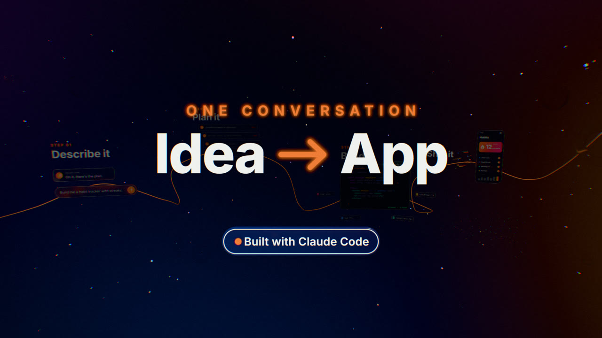

# motion3js

Motion-graphics experiments built with [Three.js](https://threejs.org/) and [Claude Code](https://claude.com/claude-code). Each one is rendered to video frame by frame and deterministically: every frame is a pure function of time, captured in headless Chromium with Playwright, and encoded with ffmpeg. Each project also builds into a single HTML page that plays live in the browser.

## Projects

| Project | |
| --- | --- |
| [**idea-to-app**](idea-to-app/)<br>A 15-second glassmorphism explainer, *From idea to app with Claude Code*. A camera flies through four frosted-glass scenes (describe, plan, build, ship), then pulls back for the reveal. | [](idea-to-app/) |

## Layout

Each project is a self-contained folder with its own dependencies, README and deploy config:

```text
motion3js/
├── PLAYBOOK.md      lessons learned, and how to start a new project
├── CLAUDE.md        guidance for Claude Code sessions in this repo
└── idea-to-app/     a project: npm install, npm run preview / render / build
```

To try a project, `cd` into it and follow its README. Typically:

```bash
npm install
npx playwright install chromium
npm run preview     # live preview
npm run render:web  # MP4 master + small web copy (needs ffmpeg)
```

## Starting a new project

Copy an existing project as a template. [PLAYBOOK.md](PLAYBOOK.md) lists which files work unchanged and which parts are specific to that project. It also records the lessons learned so far: keeping frames deterministic, render speed, Three.js glass and tone-mapping pitfalls, and the stills-first workflow.

## Deploying

Every project builds to a single static `dist/index.html` file. To host one on Vercel, import this repository and set **Root Directory** to the project's folder, for example `idea-to-app`. The project's `vercel.json` handles the rest. To host several projects, import the repository once per project, each with its own Root Directory.
