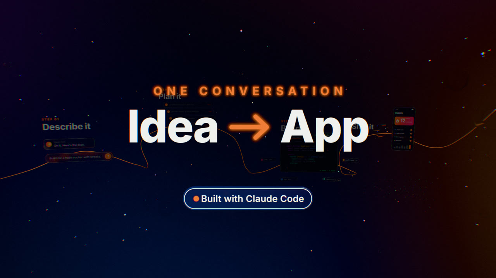
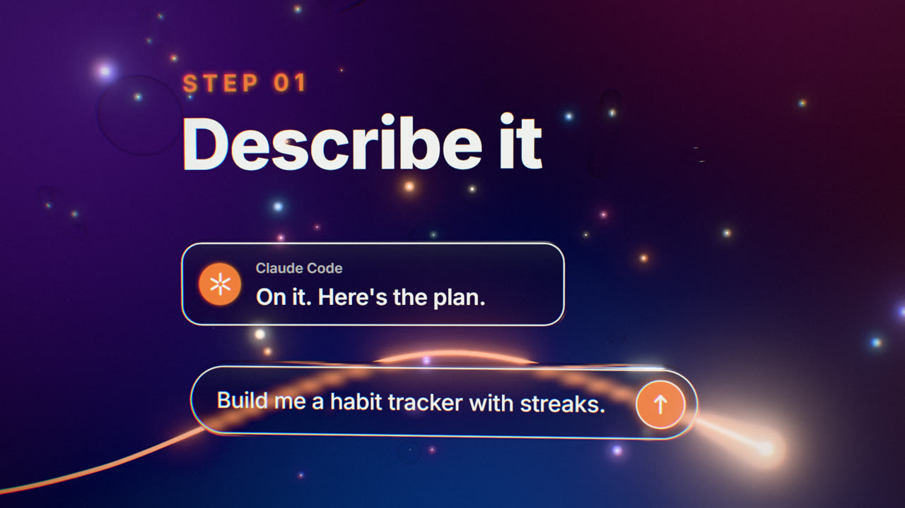
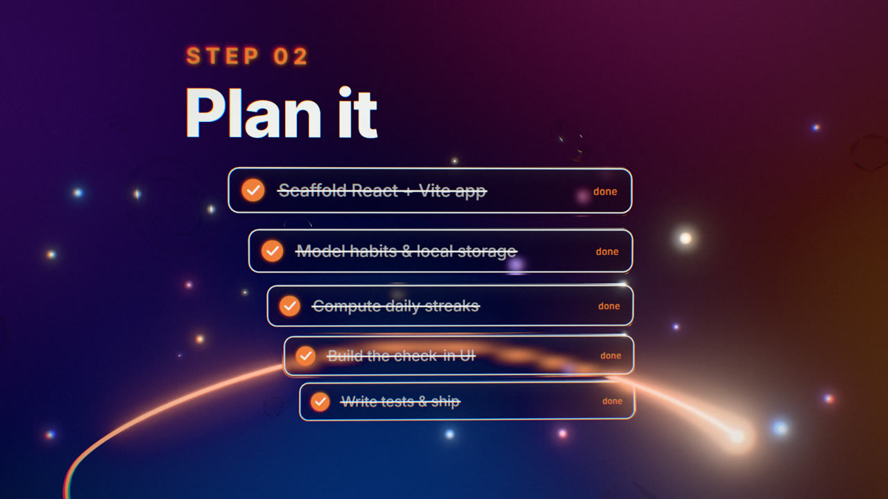
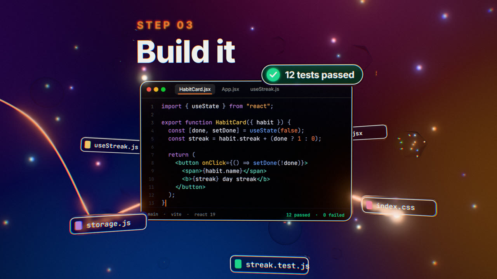
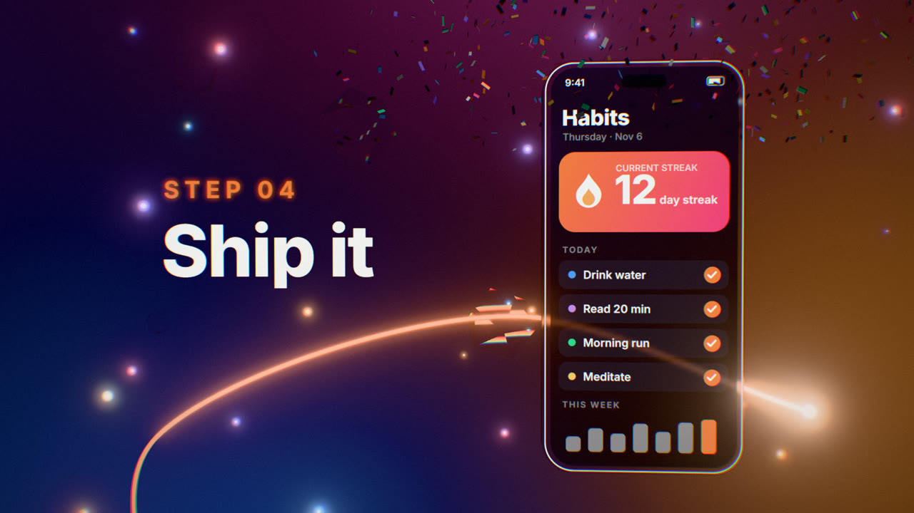

# From idea to app with Claude Code

A 15-second, 1920×1080, 60 fps motion-graphics explainer built in Three.js in a glassmorphism style. It is rendered frame by frame to MP4 with Playwright and ffmpeg. Every animation is a pure function of one time value `t`, so the same frame always renders to the same pixels.



| | |
| --- | --- |
|  |  |
|  |  |

The camera flies through four scenes, with a glowing tube connecting them:

1. **Describe it**: a prompt is typed into a chat bar.
2. **Plan it**: five tasks are ticked off.
3. **Build it**: a React component is typed out while file tiles orbit the editor.
4. **Ship it**: the finished habit app appears on a glass phone.

It then pulls back for the reveal. The whole thing was built by Claude Code from the single prompt [at the bottom of this page](#the-prompt).

## Requirements

- Node.js 18 or newer
- [ffmpeg](https://ffmpeg.org/) on your `PATH`, needed only for rendering video
- A real GPU. Headless Chromium falls back to software rendering otherwise, which is very slow.

## Getting started

```bash
npm install
npx playwright install chromium
```

| Command | What it does |
| --- | --- |
| `npm run preview` | Serves a real-time preview at <http://127.0.0.1:5173>. Space pauses, ←/→ steps one frame, and Shift+←/→ jumps one second. Add `?t=8.5` to the URL to freeze on a moment. |
| `npm run stills` | Writes PNG stills from every scene to `out/stills/`. |
| `npm run render` | Renders the full clip from lossless PNG frames to `out/from-idea-to-app.mp4`. |
| `npm run render:web` | Same as `render`, then also writes a small copy for sharing, `out/from-idea-to-app_web.mp4` (about 7 MB). |
| `npm run render:draft` | A quick preview render to `out/draft.mp4`. It captures JPEG frames instead of PNG, so it is lower quality but about twice as fast. |
| `npm run encode:web` | Re-encodes an existing master into the small web copy without rendering again. |
| `npm run build:standalone` | Builds `dist/from-idea-to-app.html`, a single 0.8 MB file with the code, three.js and fonts inlined. It opens straight from disk with no server or network. |

`render.mjs` also takes options:

```bash
node render.mjs --stills 1.5,4.6,8.9      # specific times, in seconds
node render.mjs --from 6 --to 9.5         # part of the clip
node render.mjs --fps 30 --out out/30fps.mp4
node render.mjs --workers 4               # number of parallel browsers
node render.mjs --angle gl                # override the GPU backend
```

The renderer picks the GPU backend for your platform (`d3d11` on Windows, `metal` on macOS, `vulkan` on Linux). It prints the GPU it got and warns if it fell back to software.

**Speed.** Drawing a frame takes about 26 ms on the GPU. Capturing it is the slow part: each PNG screenshot takes about 0.55 s, because the film grain makes every frame nearly incompressible. The renderer therefore runs several headless browsers in parallel, by default about one per three CPU cores and at most 12. Each browser renders every Nth frame, and a reorder buffer feeds the frames to a single ffmpeg encode in the right order. On an RTX 4090 with 32 cores, a full render takes about 70 seconds with 10 workers, compared with about 10 minutes with 1. The master file is H.264 at CRF 14 and weighs about 200 MB, again because of the grain. Use `render:web` or `encode:web` to get a copy small enough to share.

## How it works

**Deterministic rendering.** The page exposes `window.renderAt(t)`. It sets every object, every canvas texture and the camera from `t` alone, then renders once. Confetti, glass placement and film grain all use seeded random numbers, so nothing depends on the clock or `Math.random`. `render.mjs` steps `t` through `0, 1/60, 2/60, …`, screenshots each frame and pipes the PNGs into ffmpeg. A frame's pixels don't depend on which frames were drawn before it, so frames can be rendered in any order, in any number of browsers, and the result is the same. Renders with 1, 8 and 16 workers decode to identical frames. This needs the panel canvases to use Chromium's CPU 2D canvas (`willReadFrequently: true`). The default GPU-accelerated canvas caches text and shadows between draws, which made each frame depend on the ones drawn before it.

**World.** A large back-facing dome sphere uses a shader to draw soft violet, orange, blue and pink gradient blobs on near-black. A brighter copy is prefiltered once into the environment map, and that is what lights and reflects in the glass.

**Glass panels.** Each panel is a rounded, bevelled `ExtrudeGeometry` slab with a `MeshPhysicalMaterial` set to transmission 1, roughness about 0.4 and a clearcoat. A plane just in front of the slab carries a `CanvasTexture`, and the UI is drawn into it with the 2D canvas API. A panel only redraws while its content is changing.

**Camera.** Each scene has a hold window with a slow linear drift. Between holds the camera moves from one shot to the next with an `easeInOutExpo` whip, plus a small arc and roll. The reveal is a longer expo pull-back to a wide shot. The title, scrim and pill are children of the camera, so they stay fixed to the frame.

**Tube.** A `CatmullRomCurve3` runs through anchor points in every scene. A shader discards everything past the current progress value and brightens the head, and a point light rides along with it. Progress is keyed to the same hold and whip timings as the camera, so the head travels with the shot.

**Scatter.** The glass spheres, rings and icosahedrons are clear with dispersion, and the glowing orbs are instanced. They are placed by rejection sampling against roughly 750 samples of the camera path and each shot's view toward its subject, so nothing ever blocks the content.

**Post.** The post-processing chain is:

1. a half-float render target with 4× MSAA;
2. `UnrealBloomPass` with a threshold just above 1, so only HDR highlights bloom;
3. `OutputPass`, which applies neutral tone mapping and sRGB conversion;
4. a final shader pass that adds radial chromatic aberration, a vignette and film grain seeded by frame number.

## Project layout

```text
index.html            page shell: fonts, import map, preview scaling
src/main.js           renderer, dome & environment, scene placement, camera path, tube, scatter, post, timeline
src/scenes.js         the four scenes, the step labels and the reveal overlay (each is update(t))
src/lib.js            easing, seeded random numbers, canvas helpers, slab geometry, glass material, Panel class
render.mjs            Playwright + ffmpeg renderer (stills or video, parallel workers)
server.mjs            tiny static server used by preview and render
build-standalone.mjs  bundles everything into a single offline HTML file
docs/                 README images
```

Scene timings live at the top of each scene builder in `src/scenes.js`. Camera holds, scene positions and shot framing are the `sceneDefs`, `holds` and `WIDE` constants in `src/main.js`.

## Notes

- **Fonts.** The prompt asks for SF Pro, but Apple only licenses it for use on Apple platforms. The font stack lists SF Pro first and falls back to [Inter](https://rsms.me/inter/), which is bundled locally through `@fontsource`. The code editor uses JetBrains Mono. A machine with SF Pro installed renders with SF Pro instead, so its frames will differ slightly.
- **Glass behind glass.** Three.js transmission only refracts opaque objects. A glass tile that passes behind the code editor disappears until it comes back out, rather than showing through.
- **Whips have no motion blur.** A frame caught in the middle of a camera whip shows mostly background.

## The prompt

This is the prompt the project was generated from, unchanged:

> Make a 15-second, 1920×1080, 60fps motion-graphics explainer in Three.js, glassmorphism style, titled "From idea to app with Claude Code". Render it frame by frame to MP4 (Playwright plus ffmpeg), with every animation driven by a time value t so the output is deterministic.
>
> World: a dark space lit by a big dome with soft violet, orange, blue and pink gradient blobs. Panels are frosted glass (MeshPhysicalMaterial with transmission and roughness around 0.4, rounded extruded slabs). Each panel has a canvas texture on its face, redrawn every frame for the UI: a white border and white text in SF Pro. Accent colour #ff8a4c.
>
> The camera flies through 4 scenes placed at different 3D positions. It drifts slowly within each scene and whips quickly between them (expo ease). Each scene has a big label: "STEP 0X" in orange above a large white word.
>
> 1. Describe it (0—3s): a glass chat bar types "Build me a habit tracker with streaks." with a blinking cursor. The send button lights up, then a reply bubble shows typing dots followed by "On it. Here's the plan."
> 2. Plan it (3—6s): a stack of glass cards in depth. Five tasks slide in, then tick off one by one with an animated checkmark and strikethrough.
> 3. Build it (6—9.5s): a dark glass code editor with window dots and tabs types out a short React component with syntax colours. Six glass file-name tiles orbit it in 3D. It ends with a green "✓ 12 tests passed" badge.
> 4. Ship it (10—12.5s): a glass phone swings in showing the finished habit app. The streak counter counts up to 12, habits check off, a bar chart grows, and a burst of instanced confetti falls under gravity.
> 5. Reveal (12.5—15s): the camera pulls back to a wide shot showing every scene. A dark scrim fades in, then "ONE CONVERSATION / Idea → App" and a small glass pill reading "Built with Claude Code" animate in, fixed to the camera.
>
> Throughout: a glowing tube along a CatmullRom curve connects all the scenes and draws on as the story moves forward, with a bright head. Scatter clear glass spheres, rings and icosahedrons with dispersion plus small glowing orbs for parallax, and keep them away from the camera path.
>
> Finish: HDR render target with MSAA, subtle bloom (bright highlights only), neutral tone mapping, and a final pass with slight chromatic aberration, vignette and film grain. Keep all text inside the frame and clearly readable, and check still frames from every scene before rendering the full clip.
